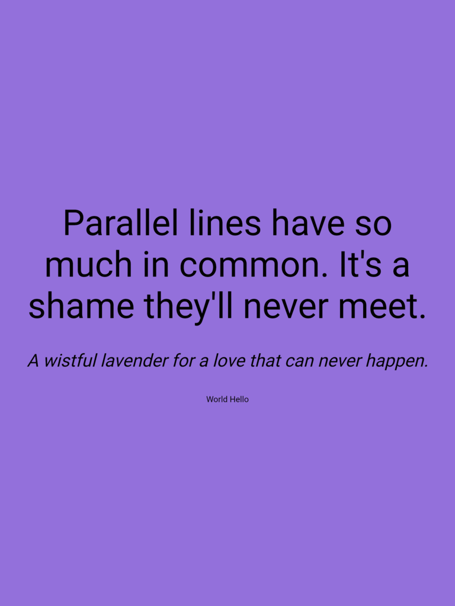
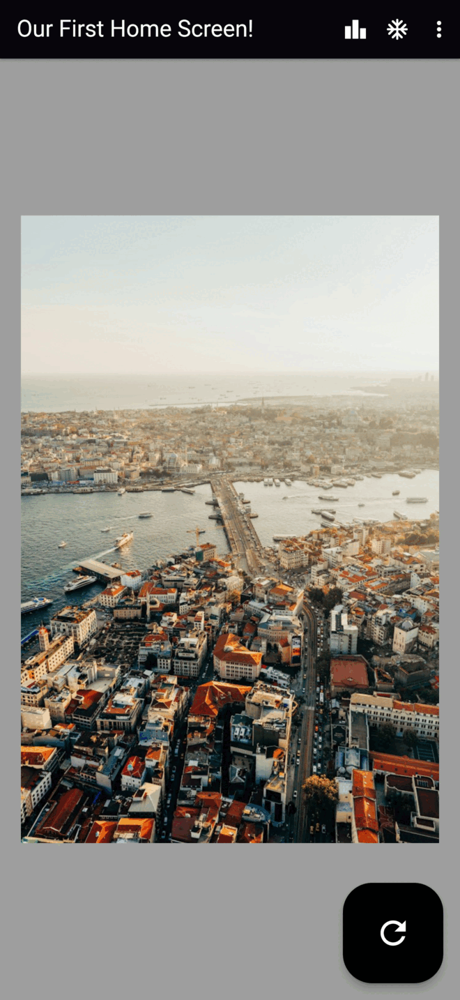

# hello_flutter_2026

*In English: the first Flutter apps from a Romanian-language course where students learn Flutter by building apps, with the help of AI. The code comments and the documentation are in Romanian.*

Primele aplicații Flutter din cursul în care învățăm Flutter construind aplicații, cu ajutorul AI.

Fiecare folder este o aplicație Flutter separată, cu codul comentat în română și cu un README care o explică pas cu pas. Aplicațiile sunt în ordinea în care le facem la curs: fiecare pornește de la ce ai învățat în cea dinainte și adaugă câteva idei noi.

## Aplicațiile

### 1. hello_flutter_1

Un text într-o casetă cu colțuri rotunjite și umbră, pe un fundal galben. Prima întâlnire cu Flutter: ce este un widget, cum se pun widget-urile unele în altele, cum rulezi aplicația în browser și pe telefon.

[Citește README-ul aplicației](hello_flutter_1/README.md)

### 2. hello_flutter_2

O glumă aleasă la întâmplare dintr-o listă de 100, pe un fundal în culoarea ei, cu explicația culorii dedesubt. Aici apare primul widget cu mai mulți children, `Column`. Aplicația se schimbă la fiecare pornire: datele sunt separate de interfață, iar interfața se construiește din ele. Lista de glume a fost scrisă cu ajutorul AI.

[Citește README-ul aplicației](hello_flutter_2/README.md)

### 3. hello_flutter_3

Un ecran adevărat de aplicație: bară de sus cu titlu, butoane și meniu cu trei puncte, o imagine de pe internet și un buton plutitor. Aici începem să organizăm codul: primele widget-uri proprii (StatelessWidget), `MaterialApp` și `Scaffold`, iar ecranul principal stă în fișierul lui, în folderul `screens/`.

[Citește README-ul aplicației](hello_flutter_3/README.md)

### Ce urmează

Vom adăuga aici aplicații noi, pe măsură ce le facem la curs: starea aplicației (state), navigarea între ecrane și altele.

## Cum începi

Ai nevoie de Flutter și de VS Code, cu extensia Flutter, instalate pe calculator.

1. Fă un **fork** al acestui repository, adică o copie în contul tău de GitHub, și clonează fork-ul pe calculator. Așa primești codul nou de la curs și îți poți salva pe GitHub și munca ta. Pașii, împreună cu celelalte variante (clone direct sau Download ZIP), sunt în [Cum urmărești codul de la curs](FOLLOW-THE-CODE.md).

2. Deschide în VS Code **folderul unei aplicații**, de exemplu `hello_flutter_1`, nu folderul `hello_flutter_2026`. Fiecare aplicație are propriile setări și propriul `pubspec.yaml`, iar comenzile `flutter` funcționează doar din folderul aplicației.

3. Urmează pașii din README-ul aplicației. Primul README explică în detaliu cum rulezi o aplicație în browser și pe telefonul Android.

Când VS Code îți propune să instalezi extensiile recomandate pentru proiect, acceptă: sunt extensiile pentru Dart și Flutter, plus câteva utile pentru lucrul cu Git și pentru găsirea caracterelor invizibile din cod.

## Fișierele din rădăcina repository-ului

- **`.editorconfig`** spune editoarelor de cod cum să salveze fișierele: codificare UTF-8, indentare cu 2 spații și sfârșit de rând de tip LF.
- **`.gitattributes`** îi spune lui Git să păstreze toate fișierele text cu sfârșit de rând LF, pe orice sistem de operare. Astfel, proiectul arată la fel pe Windows, macOS și Linux.
- **`FOLLOW-THE-CODE.md`** explică variantele prin care urmărești codul de la curs: fork, clone sau Download ZIP.
- **`LICENSE`** conține textul licenței.

## Licență

Codul este publicat sub licența MIT. Textul complet se află în fișierul [LICENSE](LICENSE).
