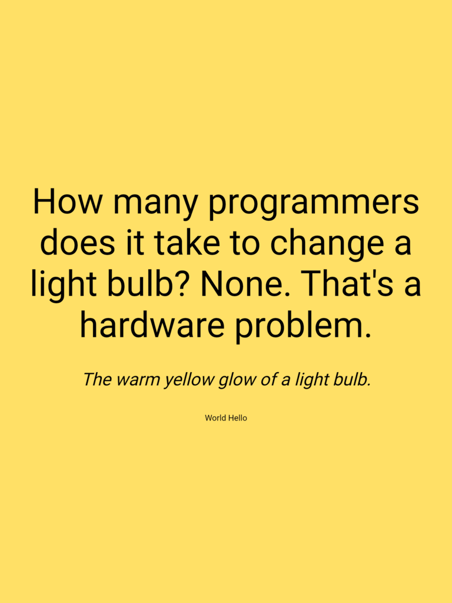
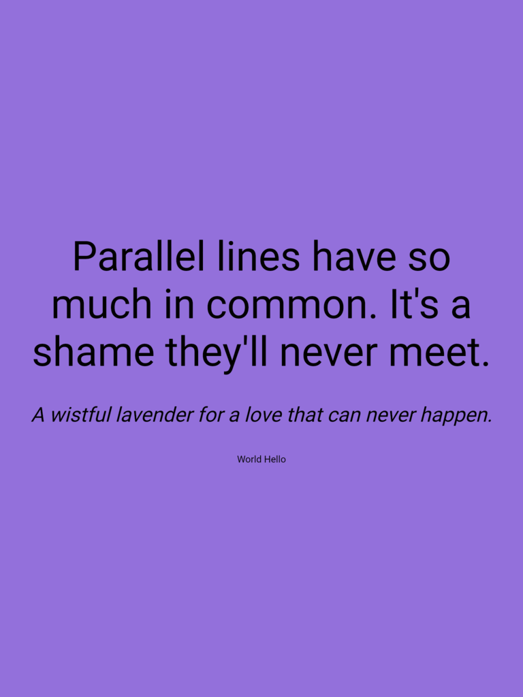

# hello_flutter_2

A doua noastră aplicație Flutter: la fiecare pornire afișează o glumă aleasă la întâmplare dintr-o listă de 100, pe un fundal în culoarea potrivită glumei, împreună cu motivul pentru care a fost aleasă culoarea.

Prima aplicație, [hello_flutter_1](../hello_flutter_1/README.md), arăta mereu același lucru. Aceasta arată de fiecare dată altceva, deși folosește aceleași idei: widget-uri puse unele în altele, construite o singură dată, în `main`. Ce s-a schimbat este că interfața nu mai este scrisă direct în cod, ci se construiește din date, și că apare primul widget cu mai mulți children: `Column`.

Ca și primul, acest README este o a doua cale de a învăța Flutter, pe lângă ce facem la curs: înveți Flutter construind aplicații. Citește-l cu codul deschis alături, în `lib/main.dart` și `lib/jokes.dart`.

 

## Cuprins

- [Ce este nou față de prima aplicație](#ce-este-nou-față-de-prima-aplicație)
- [Datele separate de interfață](#datele-separate-de-interfață)
- [Lista de glume, pas cu pas](#lista-de-glume-pas-cu-pas)
- [Alegerea glumei, pas cu pas](#alegerea-glumei-pas-cu-pas)
- [Interfața, pas cu pas](#interfața-pas-cu-pas)
- [Hot restart: o glumă nouă](#hot-restart-o-glumă-nouă)
- [Cum am folosit AI](#cum-am-folosit-ai)
- [Cum rulezi aplicația](#cum-rulezi-aplicația)
- [Încearcă și tu](#încearcă-și-tu)
- [Ce urmează](#ce-urmează)
- [Licență](#licență)

## Ce este nou față de prima aplicație

- Aplicația are **două fișiere de cod**: `jokes.dart`, cu datele, și `main.dart`, cu interfața.
- Datele sunt organizate cu tipuri din Dart: **record-uri** și **liste**.
- Aplicația alege o glumă cu **`Random`**, așa că rezultatul diferă de la o pornire la alta.
- Interfața se construiește **din date**: culoarea fundalului și textul vin din gluma aleasă, nu sunt scrise direct în cod. Același cod produce 100 de ecrane diferite.
- Apare primul widget cu **mai mulți children**: **`Column`**, care așază widget-urile unul sub altul.
- Apar widget-uri și parametri noi: **`Padding`**, **`textAlign`** și **`fontStyle`**, plus o formă scurtă de a scrie valorile, ca `.min` și `.ltr`.

Ce rămâne la fel: tot arborele de widget-uri se construiește în `main` și se afișează cu `runApp`. Dacă ideea de widget, de arbore de widget-uri sau de parametri cu nume nu îți e încă clară, citește întâi [README-ul primei aplicații](../hello_flutter_1/README.md#ideea-de-bază-totul-este-un-widget).

## Datele separate de interfață

Am fi putut scrie cele 100 de glume direct în `main.dart`. Codul ar fi funcționat la fel, dar ar fi fost greu de citit: câteva rânduri de interfață pierdute printre 500 de rânduri de glume.

De aceea, aplicația este împărțită în două fișiere, fiecare cu rolul lui:

- **`lib/jokes.dart`** conține doar datele: lista de glume, fiecare cu culoarea și explicația ei. Nu știe nimic despre widget-uri sau despre ecran.
- **`lib/main.dart`** conține doar logica și interfața: alege o glumă și o afișează. Nu știe câte glume există sau care sunt ele.

`main.dart` folosește lista din `jokes.dart` printr-un import:

```dart
import 'jokes.dart';
```

Spre deosebire de `import 'package:...'`, care aduce cod dintr-un pachet, acesta aduce cod din alt fișier al proiectului, aflat în același folder. După import, tot ce este definit în `jokes.dart` (lista `builtInJokes`) poate fi folosit în `main.dart`.

Separarea datelor de interfață este unul dintre cele mai importante obiceiuri în programare. Poți adăuga, șterge sau modifica glume fără să atingi interfața, și poți schimba interfața fără să atingi glumele.

## Lista de glume, pas cu pas

### Tipul unei glume: un record

```dart
({String text, Color color, String colorReason})
```

Fiecare glumă are trei informații: textul, culoarea și motivul culorii. Pentru a le ține împreună, Dart are **record-uri**: un grup de valori, fiecare cu numele și tipul ei.

Tipul de mai sus descrie forma record-ului: un câmp `text` de tip `String`, un câmp `color` de tip `Color` și un câmp `colorReason` de tip `String`.

Dacă ați lucrat în Java, un record din Dart seamănă cu un `record` din Java. Dacă ați lucrat în JavaScript, seamănă cu un obiect `{ text: ..., color: ..., colorReason: ... }`, cu diferența că Dart verifică tipurile: nu poți pune un număr acolo unde se așteaptă un text.

O glumă se scrie între paranteze rotunde, cu numele câmpurilor:

```dart
(
  text: 'Why do programmers prefer dark mode? Because light attracts bugs.',
  color: Color(0xFF1E1E2E),
  colorReason: 'A near-black editor background: dark mode itself.',
)
```

Iar câmpurile se citesc cu punct: `joke.text`, `joke.color`, `joke.colorReason`.

### typedef: un nume pentru tip

La începutul lui `jokes.dart` există un rând comentat:

```dart
// typedef Joke = ({String text, Color color, String colorReason});
```

`typedef` îi dă unui tip un nume scurt, aici `Joke`. Cu el, lista s-ar scrie `List<Joke>`, în loc să repete forma întreagă a record-ului. Pentru că tipul apare o singură dată în cod, l-am scris întreg, ca să se vadă direct ce conține o glumă. Când același tip apare în mai multe locuri, un nume dat cu `typedef` face codul mai ușor de citit.

### Lista builtInJokes

```dart
const List<({String text, Color color, String colorReason})> builtInJokes = [
  (...),
  (...),
];
```

- `List<...>` este o listă în care fiecare element este o glumă, adică un record cu cele trei câmpuri. Partea dintre `<` și `>` spune ce tip au elementele, ca în `List<String>` din Java.
- Lista se scrie între paranteze drepte, cu elementele separate prin virgulă, ca un array din JavaScript.
- `const` înseamnă că lista este fixă: este creată o singură dată, când se compilează aplicația, și nu poate fi modificată în timpul rulării. Nu putem adăuga sau șterge glume cât timp aplicația rulează, doar în cod.

Lista are 100 de glume, grupate pe teme: programare, științe, matematică, animale, mâncare, școală și facultate, jocuri de cuvinte. Comentariile de tipul `// Programare` marchează începutul fiecărei teme. Ele ajută doar la citirea codului: pentru Dart, lista este una singură.

### Culorile în hexazecimal

```dart
Color(0xFF1E1E2E)
```

O culoare se poate scrie ca un număr în hexazecimal (baza 16), unde `0x` arată că urmează un număr hexazecimal. Cele 8 cifre se citesc două câte două:

- `FF`, **opacitatea** (alpha): `00` este complet transparent, `FF` complet opac.
- `1E`, cantitatea de **roșu**.
- `1E`, cantitatea de **verde**.
- `2E`, cantitatea de **albastru**.

Fiecare pereche merge de la `00` (0) la `FF` (255). Ultimele 6 cifre sunt exact ca în CSS: `0xFF1E1E2E` din Flutter este culoarea `#1E1E2E` din CSS. Când găsești o culoare pe un site sau într-un program de grafică, o poți folosi în Flutter punând `0xFF` în fața codului ei.

În VS Code, culoarea apare ca un mic pătrat colorat lângă cod, iar dacă dai clic pe el, o poți alege dintr-o paletă.

### De ce sunt glumele în engleză

Glumele și explicațiile culorilor sunt în engleză, pentru că majoritatea sunt jocuri de cuvinte care funcționează doar în engleză: "I've got my ion you" ("I've got my eye on you"), "Nacho cheese" ("not your cheese"). Traduse în română, poanta s-ar pierde.

## Alegerea glumei, pas cu pas

Înainte de `runApp`, funcția `main` alege gluma în trei pași:

```dart
final randomGen = Random();
final currentJokeIndex = randomGen.nextInt(builtInJokes.length);
final joke = builtInJokes[currentJokeIndex];
```

1. `Random()` creează un generator de numere aleatoare, ca `java.util.Random` din Java. Clasa `Random` vine din biblioteca `dart:math`, importată la începutul fișierului.
2. `nextInt(n)` dă un număr întreg la întâmplare de la `0` la `n - 1`. Cu `builtInJokes.length`, adică 100, obținem un număr de la 0 la 99: exact indecșii valizi ai listei, pentru că, la fel ca în Java și JavaScript, primul element are indexul 0.
3. `builtInJokes[currentJokeIndex]` ia gluma de la acel index.

Folosind `builtInJokes.length` în loc să scriem `100` direct în cod, putem adăuga sau șterge glume fără să schimbăm nimic în `main.dart`.

### final și const

Toate cele trei variabile sunt `final`: primesc o valoare o singură dată și nu mai pot fi schimbate. Este la fel ca `final` din Java sau `const` din JavaScript.

Atunci de ce lista de glume este `const`, iar gluma aleasă este `final`? Diferența este momentul în care se cunoaște valoarea:

- **`const`**: valoarea se cunoaște când **se compilează** aplicația. Lista de glume este scrisă în cod, deci se știe dinainte.
- **`final`**: valoarea se cunoaște abia când **rulează** aplicația. Gluma aleasă depinde de un număr aleator, care nu există până nu pornește aplicația.

Tipul variabilelor nu este scris, pentru că Dart îl deduce singur din valoare: `randomGen` este un `Random`, `currentJokeIndex` un `int`, iar `joke` un record cu câmpurile `text`, `color` și `colorReason`. În VS Code, dacă ții mouse-ul deasupra numelui unei variabile, vezi tipul dedus.

## Interfața, pas cu pas

Arborele de widget-uri seamănă cu cel din prima aplicație:

```
ColoredBox          fundalul, în culoarea glumei
  Center            așază child-ul în mijloc
    Padding         spațiu gol de 40 de pixeli în jur
      Column        așază children unul sub altul
        Text        gluma
        Text        explicația culorii
        Text        un text fix: World Hello
```

Noutatea este `Column`: primul widget din curs care are mai mulți children. Până acum, fiecare widget avea un singur `child`, așa că arborele era o linie dreaptă. De la `Column` încolo, arborele se ramifică.

### Fundalul din date

```dart
ColoredBox(
  color: joke.color,
  ...
)
```

În prima aplicație, culoarea era scrisă direct în cod: `Colors.yellow`. Aici, ea vine din gluma aleasă: `joke.color`. Codul nu mai spune "fundalul este galben", ci "fundalul are culoarea glumei", oricare ar fi ea.

### Padding

`Padding` este un widget care lasă un spațiu gol în jurul child-ului. Aici, 40 de pixeli pe fiecare latură, ca textul să nu atingă marginile ecranului.

În prima aplicație, spațiul interior era dat prin parametrul `padding` al lui `Container`. Când ai nevoie doar de spațiu, fără fundal, bordură sau umbră, `Padding` este varianta mai simplă și mai clară.

### Column: mai mulți children

```dart
Column(
  mainAxisSize: .min,
  spacing: 40.0,
  children: [
    Text(joke.text, ...),
    Text(joke.colorReason, ...),
    Text('World Hello', ...),
  ],
)
```

- `children` primește o **listă** de widget-uri, scrisă între paranteze drepte, ca lista de glume. `Column` le așază unul sub altul, în ordinea din listă. Poți pune în listă oricâte widget-uri.
- `spacing: 40.0` lasă 40 de pixeli între două widget-uri vecine. Fără el, textele ar sta lipite unul de altul.
- `mainAxisSize: .min` îi spune lui `Column` să ocupe pe verticală doar cât îi trebuie pentru children. Altfel, `Column` ar ocupa toată înălțimea ecranului, iar textele ar urca sus, pentru că `Center` nu ar mai avea ce centra.

Perechea lui `Column` este `Row`, care așază widget-urile unul lângă altul, de la stânga la dreapta.

### Textele din date

Primul `Text` afișează `joke.text`, al doilea `joke.colorReason`. Fiind widget-uri separate, fiecare are stilul lui: gluma are `fontSize: 60`, iar explicația are `fontSize: 30` și `fontStyle: FontStyle.italic`, adică litere înclinate. Așa se vede ușor ce este gluma și ce este explicația.

Al treilea `Text`, `'World Hello'`, nu vine din date: este scris direct în cod și apare sub fiecare glumă. Arată că într-un `Column` se pot amesteca widget-uri construite din date cu widget-uri fixe.

### Forma scurtă: .min și .ltr

```dart
textDirection: TextDirection.ltr,
textDirection: .ltr,
```

Cele două rânduri înseamnă același lucru. Parametrul `textDirection` acceptă doar valori de tip `TextDirection`, așa că Dart știe deja tipul și putem scrie doar `.ltr`. La fel, `mainAxisSize: .min` este forma scurtă pentru `mainAxisSize: MainAxisSize.min`. În cod vei întâlni ambele forme.

### textAlign

```dart
textAlign: TextAlign.center,
```

Gluma ocupă de obicei mai multe rânduri. `Center` așază **tot** textul în mijlocul ecranului, dar fiecare rând, în interiorul textului, ar fi aliniat la stânga. `textAlign: TextAlign.center` centrează și fiecare rând în parte.

## Hot restart: o glumă nouă

La fel ca în prima aplicație, arborele de widget-uri se construiește în `main`, iar hot reload nu rulează din nou `main`. De aceea, dacă modifici codul și salvezi, pe ecran nu se schimbă nimic.

Hot restart (**Ctrl+Shift+F5** în VS Code, sau `R` în terminal) pornește aplicația din nou, de la `main`. Asta înseamnă și că se alege o glumă nouă. Apasă de câteva ori la rând și vei vedea glume și culori diferite. Uneori aceeași glumă apare de două ori la rând: e o alegere la întâmplare, iar nimic nu o împiedică să cadă din nou pe același număr.

## Cum am folosit AI

Lista de glume din `jokes.dart` a fost scrisă cu ajutorul unui asistent AI. Este o sarcină potrivită pentru AI: date multe, cu aceeași structură, care ar dura mult de scris de mână. I-am cerut glume cunoscute, potrivite pentru clasă, din mai multe domenii, fiecare cu o culoare potrivită și o explicație a culorii, scrise direct în formatul record-ului unei glume.

Rezultatul nu a fost folosit fără verificare. Ce trebuie verificat la date generate de AI:

- **Că sunt corecte.** Glumele să fie complete și să aibă sens, iar culorile să se potrivească într-adevăr cu explicațiile lor.
- **Că sunt potrivite.** Glumele să poată fi spuse în fața unei clase, fără să jignească pe nimeni.
- **Că respectă formatul.** Fiecare record să aibă toate câmpurile, cu tipurile corecte. Aici ne ajută Dart: dacă un câmp lipsește sau are alt tip, analizorul arată eroarea imediat.
- **Că nu se repetă.** AI-ul poate genera aceeași glumă de două ori, cu cuvinte puțin diferite.

AI-ul te ajută să lucrezi mai repede, dar tu rămâi responsabil pentru ce ajunge în aplicație.

## Cum rulezi aplicația

Aplicația se rulează la fel ca prima: deschide folderul `hello_flutter_2` în VS Code, alege Chrome, Edge sau telefonul în bara de jos și apasă **F5**. Din terminal, rulează comenzile din folderul `hello_flutter_2/`, de exemplu `flutter run -d chrome`.

Pașii detaliați, inclusiv cum pregătești telefonul Android, sunt în README-ul primei aplicații:

- [Cum rulezi aplicația](../hello_flutter_1/README.md#cum-rulezi-aplicația)
- [Hot reload și hot restart](../hello_flutter_1/README.md#hot-reload-și-hot-restart)
- [Comenzi utile](../hello_flutter_1/README.md#comenzi-utile)

## Încearcă și tu

Fă modificările de mai jos una câte una, cu aplicația pornită. După fiecare, salvează și apasă **Ctrl+Shift+F5** (hot restart), ca să vezi rezultatul.

1. **Adaugă gluma ta.** Scrie în `jokes.dart` un record nou, cu o glumă, o culoare și explicația culorii. Ca să o vezi sigur pe ecran, pune-o temporar prima în listă și înlocuiește în `main.dart` `currentJokeIndex` cu `0`. Apoi pune codul la loc.
2. **Provoacă o eroare.** Șterge câmpul `colorReason` din gluma ta și citește mesajul analizorului. Ce spune? Pune câmpul la loc.
3. **Adaugă o temă nouă.** Scrie un comentariu cu numele temei (de exemplu, `// Sport`) și adaugă sub el două-trei glume. Rulează `flutter test`: testul trece în continuare? De ce?
4. **Potrivește mărimea textului.** Pornește aplicația pe telefon și apasă hot restart până dai de o glumă lungă. Încape textul pe ecran? Schimbă `fontSize: 60` până când și glumele lungi încap.
5. **Schimbă stilul textului.** Adaugă în `TextStyle`-ul glumei parametrii `fontWeight: FontWeight.bold` și `color: Colors.white`. Ce se întâmplă cu glumele care au fundal deschis la culoare?
6. **Schimbă spațiul din jur.** Înlocuiește `EdgeInsets.all(40)` cu `EdgeInsets.symmetric(horizontal: 80)`. Ce s-a schimbat?
7. **Lucrează cu Column.** Schimbă `spacing: 40.0` în `0` și apoi în `100`. Mută `Text('World Hello', ...)` primul în listă. Apoi șterge `mainAxisSize: .min`: unde ajung textele și de ce?
8. **Adaugă un child.** Adaugă în `children` un al patrulea `Text`, care afișează numărul glumei: `'Gluma ${currentJokeIndex + 1} din ${builtInJokes.length}'`. `${...}` pune valoarea unei expresii în text, ca în template strings din JavaScript.
9. **Folosește typedef.** Scoate comentariul de pe rândul cu `typedef` din `jokes.dart` și scrie tipul listei ca `List<Joke>`. Aplicația funcționează la fel?
10. **Cere ajutorul AI.** Cere unui asistent AI cinci glume noi, scrise exact în formatul din `jokes.dart`. Verifică-le după lista din [Cum am folosit AI](#cum-am-folosit-ai), apoi adaugă-le în listă.
11. **Provocare: gluma zilei.** Fă aplicația să afișeze aceeași glumă toată ziua, iar a doua zi alta. Indiciu: `DateTime.now().day` dă ziua din lună, de la 1 la 31. Cum o folosești ca index în listă? Mai ai nevoie de `Random`?

## Ce urmează

Aplicația aceasta pare vie, dar nu este: gluma se alege o singură dată, la pornire, iar după aceea interfața nu se mai schimbă. Ca să vezi altă glumă, trebuie să pornești aplicația din nou.

Cum am putea schimba gluma în timp ce aplicația rulează, de exemplu cu un buton "Altă glumă"? Pentru asta, aplicația trebuie să-și amintească ce glumă afișează acum și să-și redeseneze interfața când gluma se schimbă. Asta se numește **stare** (state) și o vom învăța puțin mai târziu.

Înainte de asta, [aplicația următoare](../hello_flutter_3/README.md) face ordine în cod: mută interfața din `main` în widget-uri proprii și în fișiere separate și construiește un ecran adevărat, cu bară de sus, butoane și meniu.

## Licență

Codul este publicat sub licența MIT. Textul complet se află în fișierul [LICENSE](../LICENSE), din rădăcina repository-ului.
