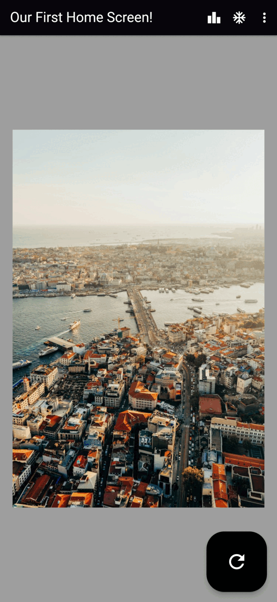

# hello_flutter_3

A treia noastră aplicație Flutter: un ecran adevărat de aplicație, cu o bară de sus care are titlu, butoane și un meniu cu trei puncte, o imagine descărcată de pe internet și un buton rotund care plutește deasupra conținutului.

Primele două aplicații, [hello_flutter_1](../hello_flutter_1/README.md) și [hello_flutter_2](../hello_flutter_2/README.md), își construiau tot arborele de widget-uri direct în funcția `main`. Pentru câteva widget-uri, asta merge. Pentru o aplicație adevărată, cu zeci de ecrane, ar fi imposibil de urmărit. De aceea, în această aplicație începem să **organizăm codul**: îl împărțim în widget-uri proprii și în mai multe fișiere, fiecare cu rolul lui.

Ca și primele două, acest README este o a doua cale de a învăța Flutter, pe lângă ce facem la curs: înveți Flutter construind aplicații. Citește-l cu codul deschis alături, în `lib/main.dart` și `lib/screens/home_screen.dart`.



## Cuprins

- [Ce este nou față de aplicațiile anterioare](#ce-este-nou-față-de-aplicațiile-anterioare)
- [De ce organizăm codul](#de-ce-organizăm-codul)
- [Widget-uri proprii: StatelessWidget](#widget-uri-proprii-statelesswidget)
- [MaterialApp](#materialapp)
- [Ecranul principal, pas cu pas](#ecranul-principal-pas-cu-pas)
- [Meniul cu trei puncte](#meniul-cu-trei-puncte)
- [const](#const)
- [Hot reload funcționează acum](#hot-reload-funcționează-acum)
- [Cum rulezi aplicația](#cum-rulezi-aplicația)
- [Încearcă și tu](#încearcă-și-tu)
- [Ce urmează: starea](#ce-urmează-starea)
- [Mai departe](#mai-departe)
- [Licență](#licență)

## Ce este nou față de aplicațiile anterioare

- Codul este împărțit în **mai multe fișiere**, iar ecranul principal stă în folderul **`lib/screens/`**.
- Scriem primele **widget-uri proprii**, cu **`StatelessWidget`** și metoda **`build`**.
- Aplicația pornește dintr-un **`MaterialApp`**, iar ecranul este construit pe un **`Scaffold`**, scheletul standard al unui ecran.
- Apar widget-uri noi: **`AppBar`**, **`IconButton`**, **`PopupMenuButton`**, **`ListTile`**, **`Image.network`** și **`FloatingActionButton`**.
- Butoanele primesc **funcții** care se apelează la apăsare, iar meniul folosește un **`enum`** și un **`switch`**.
- **Hot reload** funcționează la fiecare salvare, fără hot restart.

## De ce organizăm codul

### main face un singur lucru

În primele aplicații, `main` alegea date, construia toată interfața și o afișa. Acum, `main` are un singur rând:

```dart
void main() {
  runApp(const MyApp());
}
```

`main` doar pornește aplicația. Ce afișează aplicația este treaba widget-ului `MyApp`, iar cum arată ecranul principal este treaba widget-ului `HomeScreen`. Fiecare bucată de cod are o singură responsabilitate, iar când vrei să schimbi ceva, știi unde să cauți.

### Fișierele aplicației

```
lib/
  main.dart               pornește aplicația: main și MyApp
  screens/
    home_screen.dart      ecranul principal: HomeScreen și MenuAction
```

- **`lib/main.dart`** este punctul de intrare. Conține doar `main` și widget-ul rădăcină, `MyApp`, care configurează aplicația și alege primul ecran.
- **`lib/screens/`** este folderul ecranelor. Fiecare ecran al aplicației va avea aici fișierul lui: `home_screen.dart` acum, mai târziu poate `settings_screen.dart`, `profile_screen.dart` și așa mai departe.

`main.dart` folosește ecranul printr-un import cu calea fișierului, relativă la `main.dart`:

```dart
import 'screens/home_screen.dart';
```

### Încapsularea

Încapsularea înseamnă că fiecare bucată de cod își ascunde detaliile și arată în afară doar ce trebuie folosit. Probabil ați întâlnit ideea în Java, la clase cu câmpuri `private` și metode `public`.

Aici, `main.dart` nu știe nimic despre bara de sus, meniu sau imagine. Știe doar că există un widget `HomeScreen`, pe care îl poate afișa. Poți schimba complet ecranul principal, iar `main.dart` rămâne neatins. La fel, poți lucra la `home_screen.dart` fără să citești restul aplicației.

### Când extragi un widget

Un widget propriu se merită creat atunci când:

- **Metoda `build` devine prea lungă.** Dacă trebuie să derulezi mult ca să înțelegi ce afișează, împarte-o în widget-uri mai mici, fiecare cu un nume care spune ce este.
- **Aceeași bucată de interfață se repetă.** O scrii o singură dată, ca widget, și o folosești de câte ori ai nevoie, ca pe o funcție.
- **O parte a ecranului are un rol clar al ei.** Un meniu, un card cu un produs, o listă de rezultate: dacă îi poți da un nume, poate fi un widget.

Nu orice rând de cod trebuie mutat într-un widget separat. Un widget mic, folosit o singură dată, poate face codul mai greu de urmărit, nu mai ușor. Scopul este codul ușor de citit, nu numărul mare de fișiere.

### Numele fișierelor și ale claselor

În Dart, numele fișierelor se scriu cu litere mici și cuvintele separate prin `_`, de exemplu `home_screen.dart`. Numele claselor se scriu cu fiecare cuvânt cu literă mare, de exemplu `HomeScreen`, ca în Java. De obicei, un fișier poartă numele widget-ului principal din el.

## Widget-uri proprii: StatelessWidget

```dart
class MyApp extends StatelessWidget {
  const new({super.key});

  @override
  Widget build(BuildContext context) {
    return const MaterialApp(...);
  }
}
```

Un widget propriu este o clasă. Pe rând:

- **`class MyApp extends StatelessWidget`** declară clasa `MyApp`, care moștenește `StatelessWidget`, ca în Java. Un `StatelessWidget` este un widget fără stare: o dată construit, nu se schimbă singur.
- **`const new({super.key});`** este constructorul. `new` este forma scurtă, din versiunile noi de Dart, pentru `const MyApp({super.key});`: în loc să repeți numele clasei, scrii `new`. `const` permite crearea widget-ului la compilare, iar `{super.key}` primește un parametru opțional `key`, pe care îl trimite clasei părinte. Deocamdată nu folosim `key`, dar orice widget ar trebui să-l accepte.
- **`@override`** arată că metoda următoare înlocuiește o metodă a clasei părinte, ca adnotarea `@Override` din Java.
- **`Widget build(BuildContext context)`** este metoda care descrie ce afișează widget-ul. Nu o apelăm noi: o apelează Flutter, ori de câte ori are nevoie să deseneze widget-ul. `context` spune unde se află widget-ul în arbore. Deocamdată nu îl folosim.
- **`return ...`** întoarce arborele de widget-uri care alcătuiește widget-ul nostru, la fel cum, înainte, îl dădeam direct lui `runApp`.

`HomeScreen` este construit exact la fel. Diferența dintre ele este doar ce întoarce `build`.

## MaterialApp

```dart
return const MaterialApp(
  debugShowCheckedModeBanner: false,
  home: HomeScreen(),
);
```

`MaterialApp` este punctul de pornire obișnuit al unei aplicații Flutter. Pregătește tot ce au nevoie widget-urile Material: tema și culorile, fonturile, direcția textului și navigarea între ecrane.

- `home` este ecranul afișat când pornește aplicația.
- `debugShowCheckedModeBanner: false` ascunde eticheta roșie "DEBUG" din colțul din dreapta sus.

În primele două aplicații, fiecare `Text` avea nevoie de `textDirection: TextDirection.ltr`. Acum, `MaterialApp` stabilește direcția pentru toată aplicația, așa că parametrul nu mai apare nicăieri.

## Ecranul principal, pas cu pas

Arborele de widget-uri al ecranului:

```
Scaffold                    scheletul ecranului
  appBar: AppBar            bara de sus
    title: Text             titlul
    actions:
      IconButton            butonul cu iconița de clasament
      IconButton            butonul cu iconița de fulg de zăpadă
      PopupMenuButton       butonul cu trei puncte și meniul lui
  body: Center              conținutul, în mijloc
    Padding                 spațiu gol de 20 de pixeli în jur
      Image.network         imaginea de pe internet
  floatingActionButton:
    FloatingActionButton    butonul rotund din dreapta jos
```

### Scaffold

`Scaffold` (schelă, în engleză) este scheletul unui ecran Material. Are locuri pregătite pentru părțile obișnuite ale unui ecran, pe care le umplem prin parametri: `appBar` pentru bara de sus, `body` pentru conținut, `floatingActionButton` pentru butonul plutitor. `Scaffold` le așază singur la locul lor, așa că nu trebuie să calculăm noi unde stă fiecare.

`backgroundColor: Colors.grey` dă culoarea fundalului, în spatele conținutului.

### AppBar

```dart
AppBar(
  title: const Text('Our First Home Screen!'),
  backgroundColor: Colors.black,
  foregroundColor: Colors.white,
  elevation: 2.0,
  shadowColor: Colors.black,
  actions: [...],
)
```

- `title` este titlul din bară. Poate fi orice widget, de obicei un `Text`.
- `backgroundColor` este culoarea barei, iar `foregroundColor` este culoarea a tot ce este desenat pe ea: titlul și iconițele.
- `elevation` arată cât de ridicată pare bara deasupra conținutului. Cu cât valoarea este mai mare, cu atât umbra de sub bară este mai mare. `shadowColor` este culoarea umbrei.
- `actions` este o listă de widget-uri afișate în dreapta barei, de obicei butoane. Ca la `children` din `Column`, este o listă între paranteze drepte.

### IconButton și funcțiile pentru butoane

```dart
IconButton(
  onPressed: () {},
  icon: const Icon(Icons.leaderboard),
)
```

`IconButton` este un buton care afișează doar o iconiță. `Icons` conține sute de iconițe Material: scrie `Icons.` în VS Code și vei vedea lista.

`onPressed` primește o **funcție**, pe care Flutter o apelează când butonul este apăsat. `() {}` este o funcție fără nume, fără parametri și cu corpul gol: deocamdată, butonul nu face nimic. Seamănă cu `() => {}` din JavaScript sau cu o expresie lambda `() -> {}` din Java. Când vom vrea ca butonul să facă ceva, vom scrie codul între acolade.

### Image.network

```dart
Image.network(
  'https://plus.unsplash.com/...',
  alignment: AlignmentGeometry.center,
)
```

`Image.network` descarcă o imagine de la o adresă de pe internet și o afișează. Cât timp se descarcă, locul ei rămâne gol. `alignment` așază imaginea în mijlocul spațiului ei.

Imaginea este în `Center` și `Padding`, aceleași widget-uri ca în aplicația anterioară: imaginea stă în mijlocul ecranului, cu 20 de pixeli liberi în jur.

**Imagini de pe site-uri străine.** Imaginea noastră vine de pe Unsplash, un site care nu ne aparține. Pentru învățat este în regulă, dar o aplicație reală nu ar trebui să depindă de imagini luate direct de pe site-ul altcuiva: site-ul le poate schimba sau șterge oricând, condițiile lui de folosire s-ar putea să nu permită asta, imaginea nu apare fără internet, iar fiecare utilizator al aplicației ajunge să trimită cereri unui server străin. O aplicație reală folosește imagini proprii, incluse în aplicație (assets) sau puse pe serverul ei, ori imagini de la un serviciu ale cărui condiții permit în mod explicit afișarea lor în aplicații.

**Internetul pe Android.** O aplicație Android are nevoie de permisiunea `INTERNET` ca să descarce ceva. Flutter o adaugă singur în `android/app/src/debug/AndroidManifest.xml`, așa că imaginea apare când rulezi aplicația din VS Code. În versiunea finală (release), de exemplu cu `flutter run --release` sau `flutter build apk`, permisiunea lipsește și imaginea nu se încarcă. Pentru release, permisiunea se adaugă și în `android/app/src/main/AndroidManifest.xml`, cu rândul `<uses-permission android:name="android.permission.INTERNET"/>`, deasupra elementului `<application>`. În browser nu este nevoie de nimic.

### FloatingActionButton

```dart
FloatingActionButton.large(
  backgroundColor: Colors.black,
  foregroundColor: Colors.white,
  onPressed: () {},
  child: const Icon(Icons.refresh),
)
```

Butonul rotund care plutește deasupra conținutului, în colțul din dreapta jos. Este folosit pentru acțiunea principală a ecranului, de exemplu "scrie un mesaj nou" într-o aplicație de mesagerie. `.large` este o variantă mai mare a butonului. Există și `FloatingActionButton.small` și `FloatingActionButton.extended`, care are și text.

## Meniul cu trei puncte

### enum: o listă fixă de opțiuni

```dart
enum MenuAction { refresh, settings, logout }
```

Un `enum` definește un tip cu un număr fix de valori, ca `enum` din Java. Aici, `MenuAction` are trei valori: `MenuAction.refresh`, `MenuAction.settings` și `MenuAction.logout`, câte una pentru fiecare opțiune din meniu.

De ce nu am folosit texte, ca `'refresh'`? Pentru că, dacă greșești un text, de exemplu `'refesh'`, nimeni nu observă până nu rulează aplicația. Dacă greșești numele unei valori din `enum`, analizorul arată eroarea imediat.

`MenuAction` stă în `home_screen.dart`, lângă ecranul care îl folosește. Ce ține de un singur ecran stă în fișierul acelui ecran.

### PopupMenuButton

```dart
PopupMenuButton<MenuAction>(
  tooltip: 'More options',
  onSelected: (MenuAction item) {...},
  itemBuilder: (BuildContext context) => <PopupMenuEntry<MenuAction>>[...],
)
```

`PopupMenuButton` afișează butonul cu trei puncte. La apăsare, deschide un meniu cu opțiuni.

- `<MenuAction>` spune ce tip au valorile opțiunilor, ca la `List<String>` din Java. Așa, Dart verifică că fiecare opțiune are o valoare de tip `MenuAction`.
- `tooltip` este textul care apare când ții mouse-ul deasupra butonului, sau când ții degetul apăsat pe el, pe telefon.
- `itemBuilder` primește o funcție care construiește lista de opțiuni, de fiecare dată când se deschide meniul. `=>` înseamnă că funcția întoarce direct valoarea de după el, ca arrow functions din JavaScript.
- `onSelected` primește o funcție care se apelează când alegi o opțiune. Parametrul `item` este valoarea opțiunii alese.

### Opțiunile meniului

```dart
const PopupMenuItem<MenuAction>(
  value: MenuAction.settings,
  child: Text('Settings'),
),
const PopupMenuDivider(),
```

Fiecare `PopupMenuItem` are o valoare, `value`, pe care o primește `onSelected`, și un widget afișat, `child`. Ce se vede și ce primește codul sunt separate: poți schimba textul afișat fără să schimbi valoarea.

Prima opțiune folosește ca `child` un `ListTile`, un widget pentru rânduri cu iconiță în stânga (`leading`) și text (`title`), folosit des în liste. `PopupMenuDivider` desenează o linie orizontală între opțiuni.

### switch

```dart
switch (item) {
  case MenuAction.refresh:
    // Aici vom reîncărca datele.
    break;
  ...
}
```

`switch` alege ce cod rulează, după valoarea lui `item`, ca în Java și JavaScript. Deocamdată, fiecare `case` are doar un comentariu care spune ce va face mai târziu. Pentru că `MenuAction` are un număr fix de valori, Dart verifică dacă `switch`-ul le tratează pe toate. Dacă adaugi o valoare nouă în `enum` și uiți să o tratezi aici, analizorul te anunță.

## const

```dart
title: const Text('Our First Home Screen!'),
icon: const Icon(Icons.leaderboard),
return const MaterialApp(...);
```

Am pus `const` în fața widget-urilor care nu se schimbă niciodată. Așa cum am văzut în [prima aplicație](../hello_flutter_1/README.md#const), `const` le creează o singură dată, la compilare, iar aplicația devine puțin mai rapidă.

Când pui `const` în fața unui widget, toate widget-urile din interiorul lui devin și ele `const`. De aceea, `HomeScreen()` din `MaterialApp` nu mai are `const` în față: îl primește de la `MaterialApp`.

Nu orice widget poate fi `const`. `IconButton` nu poate, pentru că primește o funcție, `() {}`, care nu este o valoare constantă. Nici `Image.network`, care descarcă imaginea abia când rulează aplicația.

## Hot reload funcționează acum

În primele două aplicații aveai nevoie de hot restart după fiecare modificare, pentru că interfața era construită în `main`, iar hot reload nu rulează din nou `main`.

Acum, interfața este construită în metodele `build`. La hot reload, Flutter apelează din nou `build` cu codul nou, așa că schimbările apar pe ecran imediat ce salvezi fișierul (**Ctrl+S**). Este unul dintre câștigurile organizării codului în widget-uri.

Ce înseamnă hot reload și hot restart, pe larg, găsești în [README-ul primei aplicații](../hello_flutter_1/README.md#hot-reload-și-hot-restart).

## Cum rulezi aplicația

Aplicația se rulează la fel ca primele: deschide folderul `hello_flutter_3` în VS Code, alege Chrome, Edge sau telefonul în bara de jos și apasă **F5**. Din terminal, rulează comenzile din folderul `hello_flutter_3/`, de exemplu `flutter run -d chrome`. Ai nevoie de conexiune la internet, ca să se încarce imaginea.

Pașii detaliați, inclusiv cum pregătești telefonul Android, sunt în README-ul primei aplicații:

- [Cum rulezi aplicația](../hello_flutter_1/README.md#cum-rulezi-aplicația)
- [Comenzi utile](../hello_flutter_1/README.md#comenzi-utile)

## Încearcă și tu

Fă modificările de mai jos una câte una, cu aplicația pornită. După fiecare, salvează fișierul: hot reload îți arată rezultatul imediat.

1. **Schimbă bara de sus.** Scrie alt titlu și schimbă `backgroundColor` și `foregroundColor`. Mărește `elevation` la `10`. Ce se schimbă?
2. **Fă un buton să facă ceva.** Scrie în `onPressed` al unui `IconButton` rândul `debugPrint('Ai apăsat butonul!');`, între acolade. Apasă butonul și caută mesajul în panoul **Debug Console** din VS Code.
3. **Fă meniul să răspundă.** Pune câte un `debugPrint` în fiecare `case` din `switch`, cu un mesaj diferit. Alege pe rând opțiunile din meniu.
4. **Adaugă o opțiune în meniu.** Adaugă valoarea `help` în `enum MenuAction`. Ce spune analizorul despre `switch`? Tratează valoarea nouă în `switch` și adaugă un `PopupMenuItem` pentru ea.
5. **Schimbă imaginea.** Pune adresa altei imagini de pe internet. Apoi oprește internetul și pornește aplicația din nou (hot restart). Ce apare în locul imaginii?
6. **Încearcă alt buton plutitor.** Înlocuiește `FloatingActionButton.large` cu `FloatingActionButton.extended`, șterge `child` și adaugă `icon: const Icon(Icons.add)` și `label: const Text('Adaugă')`.
7. **Extrage meniul într-un widget.** Creează folderul `lib/widgets/` și în el fișierul `home_menu.dart`, cu un `StatelessWidget` numit `HomeMenu`, al cărui `build` întoarce `PopupMenuButton`-ul. Mută acolo și `enum MenuAction`. În `home_screen.dart`, importă fișierul nou și pune `const HomeMenu()` în `actions`. Ce a devenit mai ușor de citit?
8. **Creează un ecran nou.** Creează `lib/screens/settings_screen.dart`, cu un widget `SettingsScreen` care întoarce un `Scaffold` cu bara de sus și titlul "Settings". Ca să-l vezi, schimbă temporar `home` din `main.dart`. Încă nu știm să trecem de la un ecran la altul: asta vine mai târziu.
9. **Cere ajutorul AI.** Cere unui asistent AI să-ți explice, rând cu rând, ce face `PopupMenuButton` din aplicație. Apoi cere-i să propună cum ar împărți `home_screen.dart` în widget-uri mai mici. Verifică dacă propunerea face codul mai clar sau doar mai lung.
10. **Rulează testul.** Rulează `flutter test`. Apoi schimbă titlul din bara de sus și rulează-l din nou. De ce nu mai trece? Ce trebuie schimbat în `test/widget_test.dart`?

## Ce urmează: starea

Ecranul are acum butoane și un meniu, dar niciunul nu schimbă nimic pe ecran. Un `StatelessWidget`, cum îi spune și numele, nu are stare: o dată construit, arată mereu la fel.

Ca un buton să schimbe ce se vede pe ecran, de exemplu să numere apăsările sau să schimbe imaginea, aplicația trebuie să-și amintească ceva și să se redeseneze când acel ceva se schimbă. Asta se numește **stare** (state), iar widget-urile care o au se numesc `StatefulWidget`. Este subiectul aplicațiilor următoare.

## Mai departe

Documentația oficială Flutter este în limba engleză:

- [Layouts in Flutter](https://docs.flutter.dev/ui/layout), cum se așază widget-urile pe ecran.
- [Material components](https://docs.flutter.dev/ui/widgets/material), widget-urile Material, printre care `Scaffold`, `AppBar` și butoanele.
- [Guide to app architecture](https://docs.flutter.dev/app-architecture), cum se organizează codul unei aplicații Flutter mai mari.
- [Effective Dart: Style](https://dart.dev/effective-dart/style), regulile pentru numele fișierelor, claselor și variabilelor.
- [Enums](https://dart.dev/language/enums) și [Branches](https://dart.dev/language/branches), `enum` și `switch` în Dart.

## Licență

Codul este publicat sub licența MIT. Textul complet se află în fișierul [LICENSE](../LICENSE), din rădăcina repository-ului.
